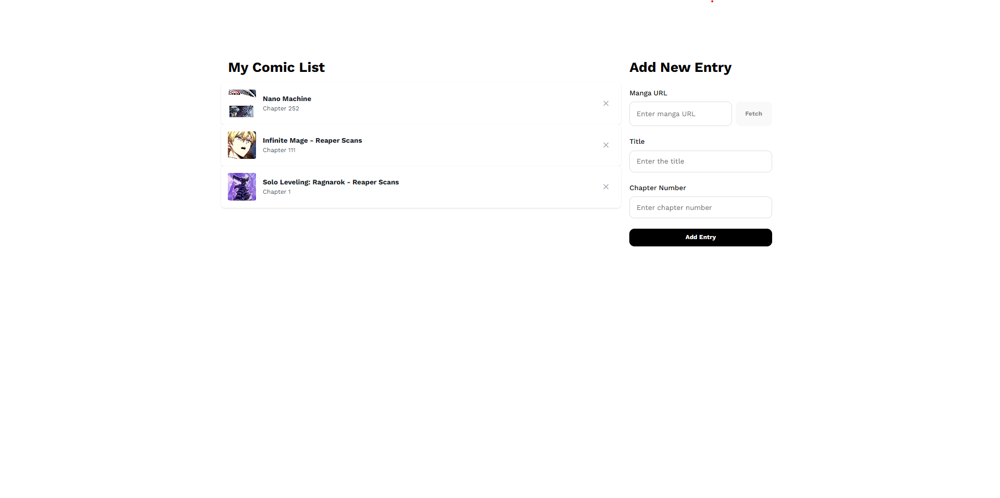
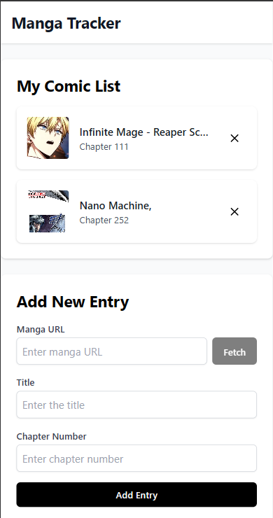

# Manga Tracker

A web app for keeping a personal list of manga, including the chapter you are on and a cover taken from a page URL.

## Features

- Lists rows from the Supabase `manga` table, newest first, with a cover, title, and chapter.
- Adds an entry from a title, chapter number, and page URL.
- Fetches a title, chapter, genre, and cover from a page URL, then shows a preview before you save. The chapter is filled when that page's title text contains a chapter number.
- Deletes an entry.
- Opens the title in a new tab when the loaded row has a URL.
- Stacks the list and the add form on narrow screens, and places them side by side from the `md` breakpoint up.

## Screenshots

### Main page



### Narrow layout



## Tech stack

- **Frontend:** React 18, TypeScript, Vite 5, Tailwind CSS, React Router 6, Axios
- **Backend:** Node.js 18 or newer, Express 4, TypeScript, Supabase (`@supabase/supabase-js`), Axios, Cheerio
- **Hosting config:** Vercel (`vercel.json` builds the frontend; `backend/vercel.json` serves the API)

## Requirements

- Node.js 18 or newer
- A Supabase project with a `manga` table the API can read and write (see [Data](#data))

## Setup

Clone the repository and install each package. Dependencies live in `backend` and `frontend`; the root `package.json` does not install them.

```bash
git clone https://github.com/inasfarras/mangaData.git
cd mangaData

cd backend
npm install

cd ../frontend
npm install
cd ..
```

### Environment

`backend/src/index.ts` reads configuration from the process environment. It does not load a `.env` file, so export these variables in the shell that starts the API:

| Variable | Required | Purpose |
| --- | --- | --- |
| `SUPABASE_URL` | yes | Supabase project URL |
| `SUPABASE_ANON_KEY` | yes | Supabase anon key |
| `PORT` | no | API port. Defaults to `3000`. |
| `FRONTEND_URL` | no | CORS origin. Defaults to `*`. |
| `NODE_ENV` | no | `production` skips `listen` and leaves the app exported for Vercel. |

```bash
export SUPABASE_URL="https://<project-ref>.supabase.co"
export SUPABASE_ANON_KEY="<anon-key>"
```

`backend/src/test-supabase.ts` and `backend/src/test-sql.ts` are the scripts that load `backend/.env` through `dotenv`.

The frontend uses `VITE_API_URL` when it is set. Otherwise `frontend/src/config.ts` calls `http://localhost:3000/api` on localhost, and `http://<current-hostname>:3000/api` on any other host. On a `*.vercel.app` host, set `VITE_API_URL` to the deployed API, including the `/api` suffix. Without that variable, the client uses a placeholder URL and does not reach a backend.

### Run locally

Start the API from the repository root:

```bash
npm run dev:backend
```

That runs `nodemon --exec ts-node src/index.ts` in `backend` and listens on `http://0.0.0.0:3000` unless `PORT` is set. Leave `NODE_ENV` unset, or set it to something other than `production`, so the process calls `listen`.

In a second terminal, start the frontend:

```bash
npm run dev:frontend
```

Vite serves the UI at [http://localhost:5174](http://localhost:5174). `frontend/vite.config.ts` sets `port: 5174` and `strictPort: true`.

`npm start` from the repository root runs the API once with `ts-node`. `npm run build` installs frontend dependencies and runs `vite build`.

### Use the app

1. Open [http://localhost:5174](http://localhost:5174).
2. Enter a manga page URL and choose **Fetch**, or type the title and chapter yourself. **Fetch** sends `POST /api/manga/scrape` and fills the title, a chapter number when the page title contains one, a genre, and a cover image.
3. Choose **Add Entry**. The form requires a title, a chapter number, and a URL. The API stores `title`, `chapter`, `genre`, and `image_url`. The insert does not write `url`.
4. The new card keeps the URL you just submitted, so the title is clickable until the next reload. After a reload, the title links to the row's `url` column when that column exists.
5. Remove a row with the × control. That sends `DELETE /api/manga/:id`.

From another device on the same network, open `http://<this-computer-LAN-address>:5174`. The API listens on all interfaces, and the client then calls port `3000` on that same host.

Check the API with `GET http://localhost:3000/api/health`. The payload reports whether `SUPABASE_URL` and `SUPABASE_ANON_KEY` are set. It does not query the database.

## Data

The manga routes use a Supabase table named `manga`:

- `id` — identifies a row for delete
- `title` — stored and shown in the list
- `chapter` — stored as a number
- `genre` — stored when a scraped genre is present and is not the string `Unknown`; otherwise `null`. Shown in the fetch preview, and omitted from list cards
- `image_url` — cover URL. When none is found, the scraper and the add form use a built-in placeholder image
- `created_at` — list order, newest first
- `url` — read while listing, when the column is present. Create does not insert it

`GET /api/manga` returns every row in the table. The query does not filter by user.

## API

| Method | Path | Behavior |
| --- | --- | --- |
| `GET` | `/api/health` | Returns status, a timestamp, and which related environment variables are set |
| `GET` | `/api/manga` | Returns all manga rows, newest first |
| `POST` | `/api/manga` | Inserts `title`, `chapter`, `genre`, and `image_url` |
| `DELETE` | `/api/manga/:id` | Deletes one row |
| `POST` | `/api/manga/scrape` | Body `{ "url": "<page url>" }`. Reads the page with Axios and Cheerio and returns `title`, `chapter`, `genre`, and `imageUrl` |

## Other files in the repository

These files are checked in and are not registered by the running app:

- `frontend/src/pages/SqlEditorPage.tsx` is a route at `/sql`. The page posts SQL to `http://localhost:3000/api/sql`, and `backend/src/routes/sql.ts` would forward that body to a Supabase RPC named `exec_sql`. `backend/src/index.ts` mounts `/api/manga` only, so that route is not served. The SQL page uses Monaco Editor. The header in `frontend/src/components/Layout.tsx` does not link to `/sql`.
- `frontend/src/pages/Login.tsx` and `frontend/src/pages/Register.tsx` contain sign-in and sign-up forms. `frontend/src/App.tsx` does not route them, and both submit handlers are unfinished. `backend/src/routes/auth.ts` defines Supabase sign-up, sign-in, and sign-out handlers and is not imported by the server.

## License

Released under the [MIT License](LICENSE). Copyright 2026 Farras Inas.
